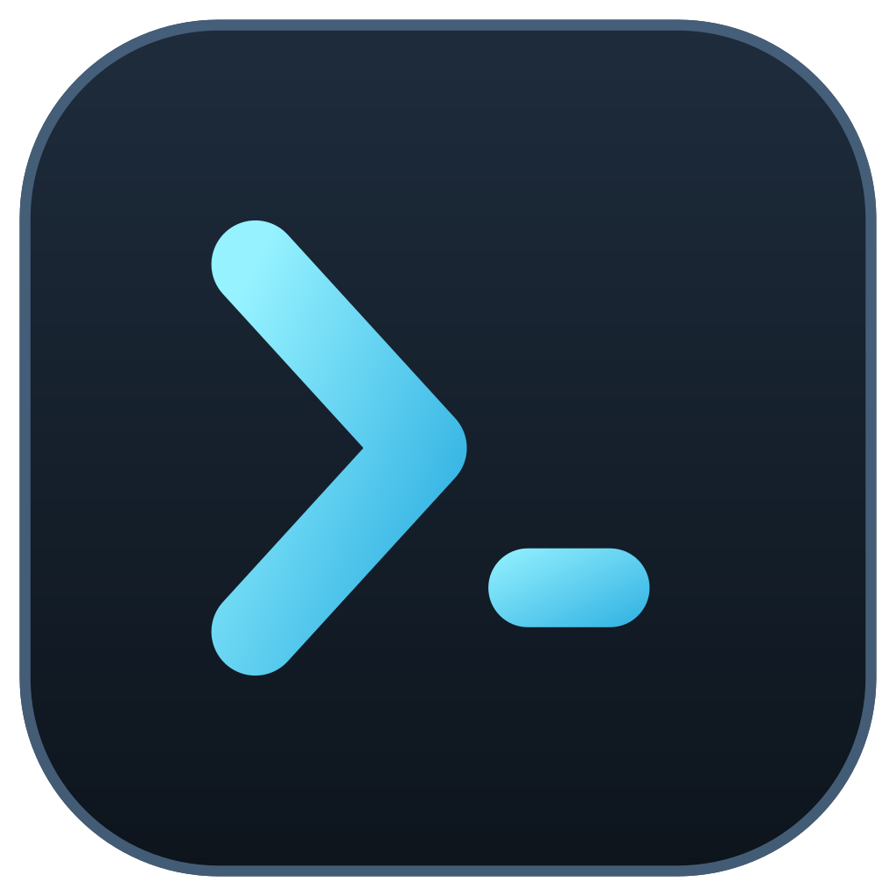
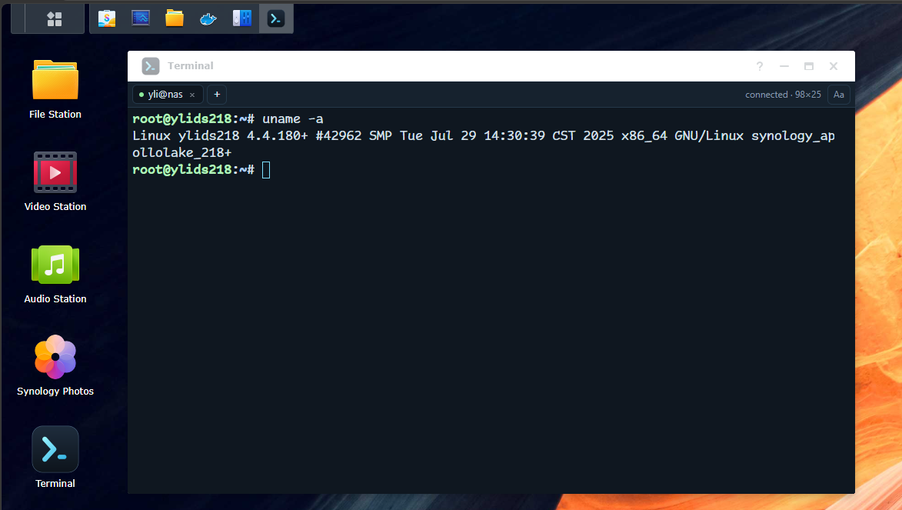

# synoterm

A terminal for Synology DSM: **xterm.js** renders it in the browser, a small
**Zig** binary owns the PTY, and it ships as a native `.spk` with no runtime
dependencies on the NAS. It runs either as its own page behind DSM's reverse
proxy or as a window inside the DSM desktop.



## Features

- Real terminal on a PTY, multiple tabs/windows, resize, scrollback
- xterm.js rendering with font/size/line-height settings
- Logs in as your own DSM account over SSH: DSM's sshd owns the password, the
  2FA prompt and the account policy, and the prompt is the terminal itself
- Optional DSM-session mode (cookie + SynoToken) for a password-free start
- Static musl binary: x86_64, aarch64, armv7
- No runtime dependencies on the NAS

## Scope

**Target: DSM 7.0/7.1** (verified on DSM 7.1.1-42962 / DS218+). The desktop
window is registered as an ExtJS app. DSM 7.2's Vue window is a build flag
(`SYNOTERM_UI_STYLE=vue`), not the target.

In scope: terminal (real PTY, resize, tabs, scrollback, font settings);
x86_64/aarch64/armv7 static musl binaries; account integration (SSH login as your
DSM account, or the DSM session itself); DSM's reverse proxy or its existing
nginx vhost; no Python/Node on the NAS; unsigned packages.

Out of scope for 1.x: sessions surviving window close; file manager/SFTP; DSM 6.x
and 7.2+ as primary target; signed packages.

## Install on DSM 7.1

1. **Package Center → Manual Install** → `synoterm-<version>-<arch>.spk`
   (architecture per `uname -m`: `x86_64`, `aarch64` → armv8, `armv7`).
   DSM 7 refuses CLI installs of unsigned packages
   (`error 320, non-synology-signed package should not use internal worker`), so
   the install must go through Package Center's UI.

2. **Enable SSH** (*Control Panel → Terminal & SNMP → Enable SSH service*). The
   terminal logs in through DSM's own sshd, so the password, 2FA code and account
   policy are DSM's — synoterm never sees a DSM cookie or token.

3. **Expose the backend through DSM's reverse proxy** (no root shell needed):

   *Control Panel → Login Portal → Advanced → Reverse Proxy → Create*

   | field | value |
   | --- | --- |
   | Source protocol / hostname / port | `HTTPS` / `nas` / `7171` (any free port) |
   | Destination protocol / hostname / port | `HTTP` / `localhost` / `7381` |
   | Path | `/` |

   DSM keeps that rule in its own configuration, so it survives DSM and package
   upgrades (unlike a file dropped into `/etc/nginx/conf.d`). Leave the custom
   headers alone: DSM already forwards `Upgrade`/`Connection` for WebSockets.

   Then open `https://nas:7171/` and type your DSM account; the terminal asks for
   the password. `BASE_PATH=""` in `/var/packages/synoterm/var/etc/synoterm.conf`
   is what makes the app sit at the proxy root (`/synoterm` is the packaged
   default; see `docs/dsm-integration.md` §4.3).

   *Alternative, no extra port:* as root, `contrib/install-nginx-mount.sh` hooks
   the same backend into DSM's existing `:5001` vhost at `/synoterm/`. Keep
   `BASE_PATH="/synoterm"` for that, or mount it in the DSM desktop window from
   step 4.

4. **Optional: keep the DSM desktop entry.** *DSM → main menu → Terminal* opens
   the same UI in a DSM window (an iframe around
   `/webman/3rdparty/synoterm/web/`). That page has no backend of its own, so
   point it at the rule from step 3 — otherwise it falls back to the
   loopback-only `:7381` and says "server not reachable":

   ```sh
   sed -i 's/^PROXY_HTTPS_PORT=.*/PROXY_HTTPS_PORT="7171"/' \
     /var/packages/synoterm/var/etc/synoterm.conf
   synopkg restart synoterm
   ```

   This survives DSM and package upgrades; the `/etc/nginx/conf.d` mount from the
   contrib helper does not (DSM rebuilds that directory whenever a package is
   installed). Keep `BASE_PATH="/synoterm"` either way.

**Authentication modes** (`AUTH=` in
`/var/packages/synoterm/var/etc/synoterm.conf`):

| `AUTH` | how the user is identified | needs |
| --- | --- | --- |
| `ssh` (default) | `ssh -l <account> 127.0.0.1`: DSM's sshd shows the password/OTP prompt **in the terminal** | the SSH service enabled |
| `dsm` | the browser's DSM session (cookie + SynoToken) is replayed to `authenticate.cgi`; the shell is forked as that account | a build with `SYNOTERM_SETUID=1` |

`ssh` needs no setuid binary, no DSM token and no webman — which is why it is the
default. An existing install keeps DSM mode only if its `synoterm.conf` still
says `AUTH="dsm"`; the file is never rewritten on upgrade.

Upgrading is step 1 again (install over the old version); `contrib/` changes too,
so re-run step 3's helper only if you use it. Removing:

```sh
sudo /var/packages/synoterm/target/contrib/uninstall-nginx-mount.sh   # if you used it
```

Troubleshooting in one command:

```sh
sudo /var/packages/synoterm/target/contrib/diagnose.sh
```

## High-level overview

```
browser ⇄ https://nas:7171/  (DSM reverse proxy)
          or https://nas:5001/synoterm/  (contrib nginx snippet)
          or the DSM desktop window (iframe)
       xterm.js  ⇄  /ws
                              ▼
  synoterm (Zig, static musl) on 127.0.0.1:7381
                              ▼  AUTH=ssh (default)
  /dev/ptmx ── exec ssh -l <account> 127.0.0.1 ── DSM sshd ── your shell
                              │ AUTH=dsm
                    authenticate.cgi → fork as that user (setuid build)
```

Target: DSM 7.0/7.1 (verified on DSM 7.1.1-42962 / DS218+). DSM 7.2 Vue window
is a build flag (`SYNOTERM_UI_STYLE=vue`), not the target.

## Develop

Prerequisites: Zig, Node.js, npm.

```sh
# frontend
cd frontend && npm install && npm run build

# backend
zig build
zig build test

# end-to-end
npm install   # repo root
node tools/e2e.mjs
```

Package a `.spk`:

```sh
./tools/build-spk.sh x86_64 <version>
./tools/verify-spk.sh build/<file>.spk
```

More background and design decisions: [docs/history.md](docs/history.md).
