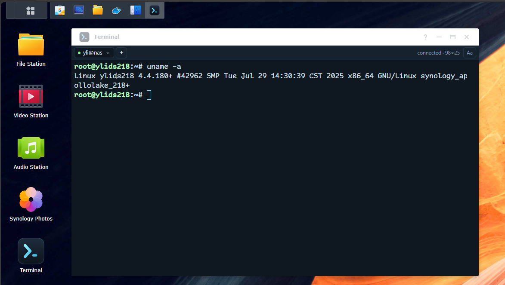

# synoterm

A terminal that opens **inside the Synology DSM desktop** as a real desktop
window: **xterm.js** renders it, a small **Zig** binary owns the PTY, and it
ships as a native `.spk` with no runtime dependencies on the NAS.



## Features

- Real PTY with `/bin/bash` (or the logged-in user's shell)
- Multiple terminal windows, resize, scrollback
- xterm.js rendering with font/size/line-height settings
- Runs as the logged-in DSM user (DSM account integration)
- Static musl binary: x86_64, aarch64, armv7
- No runtime dependencies on the NAS

## Scope

**Target: DSM 7.0/7.1** (verified on DSM 7.1.1-42962 / DS218+). The desktop
window is registered as an ExtJS app. DSM 7.2's Vue window is a build flag
(`SYNOTERM_UI_STYLE=vue`), not the target.

In scope: terminal (real PTY, resize, multiple windows, scrollback, font settings);
x86_64/aarch64/armv7 static musl binaries; DSM account integration (shell runs as
the logged-in DSM user, admins only, local accounts only); no SSH/Python/Node on
the NAS; unsigned packages (two-step install).

Out of scope for 1.x: sessions surviving window close; file manager/SFTP; DSM 6.x
and 7.2+ as primary target; signed packages.

## Install on DSM 7.1

1. **Package Center → Manual Install** → `synoterm-<version>-<arch>.spk`
   (architecture per `uname -m`: `x86_64`, `aarch64` → armv8, `armv7`).
   DSM 7 refuses CLI installs of unsigned packages
   (`error 320, non-synology-signed package should not use internal worker`), so
   the install must go through Package Center's UI.

2. **One-time, as root — mount the terminal on DSM's web server:**

   ```sh
   sudo /var/packages/synoterm/target/contrib/install-nginx-mount.sh
   ```

   **Why this step exists:** the clean way to reach a WebSocket is DSM's own nginx
   (`https://nas:5001/synoterm/…`), and DSM exposes that as a *package resource*
   handled by one of its **internal workers**. DSM 7 only lets
   Synology-signed packages use internal workers — a self-built package is
   rejected before it is installed. So the package ships the same nginx snippet
   as a file and this helper applies it from your root shell instead: it finds a
   directory nginx already includes inside a `server {}` block, runs `nginx -t`,
   **removes the file again if nginx would reject it**, then restarts nginx.

   *Optional.* Skip it and the app still works: DSM serves the UI from
   `ui/web`, and the terminal listens on port 7381 of the NAS (allow TCP 7381 in
   *Control Panel → Security → Firewall*). The UI detects which mode is available
   (`window.synotermBackend` in the console shows `proxy` or `direct`).

3. **DSM → main menu → Terminal.** The shell runs as your DSM account; check with
   `id`, `pwd`, `stty size`.

Upgrading is step 1 again (install over the old version); `contrib/` changes too,
so re-run step 2 only if the helper's output asks you to. Removing:

```sh
sudo /var/packages/synoterm/target/contrib/uninstall-nginx-mount.sh   # before uninstalling
```

Troubleshooting in one command:

```sh
sudo /var/packages/synoterm/target/contrib/diagnose.sh
```

## High-level overview

```
DSM desktop (http://nas:5000)
  Terminal window (iframe)  ⇄  /synoterm/ws  (nginx mount, or the package port)
       xterm.js
                              │ DSM cookie + SynoToken
                              ▼
  synoterm (Zig, static musl) on 127.0.0.1:7381
                              │ authenticate.cgi → DSM user
                              ▼
  /dev/ptmx ── fork ── setuid(user) ── exec shell
```

Target: DSM 7.0/7.1 (verified on DSM 7.1.1-42962 / DS218+). DSM 7.2 Vue window
is a build flag (`SYNOTERM_UI_STYLE=vue`), not the target.

## Develop

Prerequisites: Zig, Node.js, npm.

```sh
# frontend
cd frontend && npm install && npm run build

# backend
zig build
zig build test

# end-to-end
npm install   # repo root
node tools/e2e.mjs
```

Package a `.spk`:

```sh
./tools/build-spk.sh x86_64 <version>
./tools/verify-spk.sh build/<file>.spk
```

More background and design decisions: [docs/history.md](docs/history.md).
