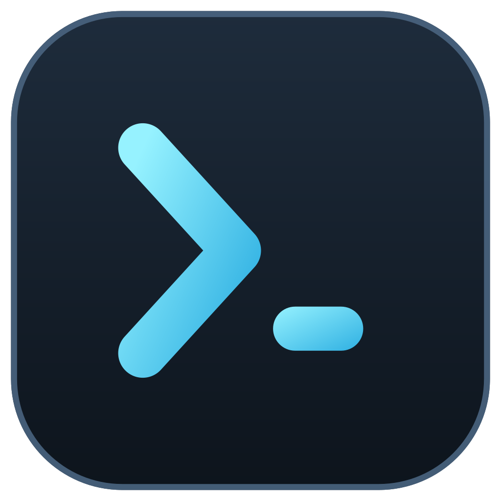

# synoterm

A terminal that opens **inside the Synology DSM desktop** as a real desktop
window: **xterm.js** renders it, a small **Zig** binary owns the PTY, and it
ships as a native `.spk` with no runtime dependencies on the NAS.

```
 DSM desktop (http://nas:5000)                        DSM 7.1 window (ExtJS)
 ┌──────────────────────────────────────────────────────────────────────┐
 │  Terminal  window  (SYNO.SDS.App.Synoterm.Instance)                  │
 │  ┌────────────────────────────────────────────────────────────────┐  │
 │  │  iframe → /webman/3rdparty/synoterm/web/index.html             │  │
 │  │  xterm.js  ⇄  ws://nas:7381/ws        (own port, cookie sent)  │  │
 │  │            ⇄  /synoterm/ws            (optional nginx mount)   │  │
 │  └────────────────────────────────────────────────────────────────┘  │
 └──────────────────────────────────────────────────────────────────────┘
                              │ DSM cookie + SynoToken
                              ▼
                 127.0.0.1:7381 or 0.0.0.0:7381  synoterm (Zig, setuid tool)
                              │  authenticate.cgi → DSM user
                              ▼
                 /dev/ptmx ── fork ── setuid(user) ── exec /bin/bash
```

## Scope

**Target: DSM 7.0/7.1.** Verified on **DSM 7.1.1-42962 (DS218+)**. The desktop
window is registered as an ExtJS app (`type: "app"` + `SYNO.SDS.AppWindow`),
which is what DSM 7.0/7.1 still use. DSM 7.2's Vue window is a build flag
(`SYNOTERM_UI_STYLE=vue`), not the target, and `url` (a browser popup) exists only
as a diagnostic fallback.

In scope:

* a **terminal** — real PTY, real shell, resize, multiple windows, scrollback,
  font/size/line-height settings;
* **x86_64, armv8 (aarch64), armv7** — one static musl binary per architecture;
* **DSM account integration** — the shell runs as the logged-in DSM user, admin
  group only, local DSM accounts only (domain/LDAP accounts are refused);
* **no new services required** — no SSH, no Python, no Node.js on the NAS.

Out of scope for 1.x:

* sessions that survive closing the window (deliberate: closing the terminal ends
  the shell; `libghostty-vt` persistence is designed but deferred);
* file manager / upload / SFTP features;
* DSM 6.x, DSM 7.2+ window frameworks as the primary target;
* signed packages — builds are unsigned, which is why installation has two steps.

## Install on DSM 7.1

1. **Package Center → Manual Install** → `synoterm-<version>-<arch>.spk`
   (architecture per `uname -m`: `x86_64`, `aarch64` → armv8, `armv7`).
   DSM 7 refuses CLI installs of unsigned packages
   (`error 320, non-synology-signed package should not use internal worker`), so
   the install must go through Package Center's UI.

2. **One-time, as root — mount the terminal on DSM's web server:**

   ```sh
   sudo /var/packages/synoterm/target/contrib/install-nginx-mount.sh
   ```

   **Why this step exists:** the clean way to reach a WebSocket is DSM's own nginx
   (`https://nas:5001/synoterm/…`), and DSM exposes that as a *package resource*
   handled by one of its **internal workers**. DSM 7 only lets
   Synology-signed packages use internal workers — a self-built package is
   rejected before it is installed. So the package ships the same nginx snippet
   as a file and this helper applies it from your root shell instead: it finds a
   directory nginx already includes inside a `server {}` block, runs `nginx -t`,
   **removes the file again if nginx would reject it**, then restarts nginx.

   *Optional.* Skip it and the app still works: DSM serves the UI from
   `ui/web`, and the terminal listens on port 7381 of the NAS (allow TCP 7381 in
   *Control Panel → Security → Firewall*). The UI detects which mode is available
   (`window.synotermBackend` in the console shows `proxy` or `direct`).

3. **DSM → main menu → Terminal.** The shell runs as your DSM account; check with
   `id`, `pwd`, `stty size`.

Upgrading is step 1 again (install over the old version); `contrib/` changes too,
so re-run step 2 only if the helper's output asks you to. Removing:

```sh
sudo /var/packages/synoterm/target/contrib/uninstall-nginx-mount.sh   # before uninstalling
```

Troubleshooting in one command:

```sh
sudo /var/packages/synoterm/target/contrib/diagnose.sh
```

## Why this shape

* **No SSH required.** The original sketch for a DSM web terminal proxies to
  `127.0.0.1:22`. That needs SSH enabled, a password typed into the browser,
  and it breaks for 2FA/LDAP accounts. Instead, the backend asks DSM who the
  browser session belongs to (`authenticate.cgi`) and forks a PTY **as that
  user** — the same thing DSM's own terminal tooling does.
* **No internal worker.** DSM 7 only lets Synology-signed packages use the
  framework's internal workers, and the nginx mount is one of them. The package
  therefore ships the snippet as a file and a root helper applies it once — see
  [Install](#install-on-dsm-71) and
  [docs/dsm-integration.md §4](docs/dsm-integration.md#4-transport-ship-the-mount-apply-it-by-hand).
  Cookies are host-scoped, not port-scoped, so the same DSM session also
  authenticates the direct (`nas:7381`) transport: the mount is about HTTPS and
  same-origin convenience, not about auth.
* **One static binary.** Zig cross-compiles to `x86_64`/`aarch64`/`armv7`
  **static musl** binaries; libc is embedded, so the binary does not depend on
  DSM's glibc (7.1 ships 2.26, while a native build needs 2.36+). No Node.js, no
  Python, no runtime dependencies on the NAS.
* **Appearance that fits your eyes.** Font family, size and line height are
  adjustable from the `Aa` button on the right of the header (persisted per
  browser) or from the URL:
  `?fontFamily=Fira+Code&fontSize=16&lineHeight=1.4`.
* **Normal clipboard behaviour.** `Ctrl/Cmd+V` pastes (also `Ctrl+Shift+V` and
  `Shift+Insert`), `Ctrl/Cmd+C` copies a selection — and only sends `^C` when
  nothing is selected — and pasting works even when focus is on the DSM window
  chrome rather than the terminal.
* **Small surface, explicit lifecycle.** xterm.js renders, the backend owns the
  real PTY, and a session ends when its socket ends (v1 policy). Persistent
  sessions via `libghostty-vt` are designed and deliberately deferred.

## Status

| Piece | State |
| --- | --- |
| Zig backend (HTTP, WebSocket, PTY bridge, resize) | working, unit tested |
| xterm.js frontend (tabs, reconnect, fit, status bar, font settings) | working, e2e tested in headless Chromium |
| DSM package (`INFO`, `conf/privilege`, ExtJS app window, contrib helpers) | **installed and running on a DS218+ / DSM 7.1.1** |
| DSM session auth (`authenticate.cgi` + group check) | **working on DSM 7.1.1** (cookie + SynoToken; `ui/auth-probe.cgi` reports what DSM hands a package CGI) |
| Multi-arch SPK build (`tools/build-spk.sh`) | working (x86_64 verified, armv8/armv7 cross-compiled) |
| v1 policy: DSM 7.1 floor, admins only, local accounts only, kill on disconnect | implemented |
| Service config (`$SYNOPKG_PKGVAR/etc/synoterm.conf`: require-group, max sessions) | implemented |
| Persistent sessions / reattach (`libghostty-vt`) | deferred (v1 kills sessions on disconnect); design kept in docs |

The full roadmap, decisions, risks and open questions are in
**[docs/PLAN.md](docs/PLAN.md)**.

## Quick start (Linux/macOS, no NAS)

```sh
zig build -Doptimize=ReleaseSmall          # static musl, no glibc needed
(cd frontend && npm install && npm run build)

./zig-out/bin/synoterm \
  --listen 8080 --auth dev --web-root frontend/dist
# open http://127.0.0.1:8080/
```

Dev mode trusts the caller and runs the shell as *you*. Never expose it.

`zig build` produces the static musl binary by default; use
`zig build -Dtarget=native` if you deliberately want a dynamically linked
build (e.g. to profile with your distro's tools).

Run the tests:

```sh
zig build test
node tools/e2e.mjs          # needs a Chromium; see the script header
```

## Releasing

Pushing a version tag builds every architecture and publishes a GitHub Release
with the `.spk` files, a `SHA256SUMS`, and the install/upgrade/rollback steps:

```sh
git tag -a v0.1.1 -m "synoterm 0.1.1"
git push origin v0.1.1
```

The tag becomes the DSM package version: `v0.1.1` → `0.1.1-<CI run number>`,
`v0.1.1-42` → `0.1.1-42` (explicit build number, for a re-release), and
`v0.1.1-rc1` marks the release as a prerelease. The workflow
(`.github/workflows/release.yml`) runs the unit tests and the static/glibc check
before packaging, then verifies each `.spk` with `tools/verify-spk.sh`.

## Build a DSM package

```sh
./tools/build-spk.sh x86_64 0.1.1-0001     # → build/synoterm-0.1.1-0001-x86_64.spk
./tools/build-spk.sh armv8  0.1.1-0001
./tools/build-spk.sh armv7  0.1.1-0001

# DSM 7.2 desktop framework (v-app-window) instead of the 7.1-safe .url style:
SYNOTERM_UI_STYLE=vue ./tools/build-spk.sh x86_64 0.1.1-0001
```

Default UI style is `url` (documented for 7.x, works on the 7.1 floor). Under
that style DSM injects no CSRF token, so the backend authenticates with the DSM
session cookie; if a 7.1 device turns out to require a token, build the `vue`
style (7.2) or add the ExtJS wrapper described in
[docs/dsm-integration.md](docs/dsm-integration.md#53-fallback-if-71-needs-a-token-extjs-wrapper).

Install on the NAS: **Package Center → Manual Install**. DSM 7 refuses
unsigned packages by default; set *Package Center → Settings → General →
Trust Level* to allow any publisher (see
[docs/dsm-integration.md](docs/dsm-integration.md#installing-an-unsigned-spk)).

## Repository layout

```
src/                     Zig backend
  main.zig               CLI, HTTP/WS routing, auth, session wiring
  ws.zig                 RFC 6455 handshake + frame codec
  http.zig               request parsing, static files, traversal protection
  session.zig            PTY spawn (setuid, groups, env) + output pump
  auth.zig               DSM authenticate.cgi bridge
  sys.zig                raw syscall layer (the only file tied to Linux/Zig internals)
  util.zig               allocator/list/mutex shims for Zig 0.17
frontend/                xterm.js UI (esbuild bundle, no framework)
packaging/dsm7/          DSM 7 package skeleton (INFO, conf, nginx, ui, scripts)
assets/icon.svg          app icon (generated by tools/make-icons.py; PNGs derive from it)
tools/                   build-spk.sh, verify-spk.sh, make-icons.py, dev.sh,
                         e2e.mjs, ws-test.mjs,
                         nas-install.sh (install on a NAS),
                         nas-test.sh (full checklist run),
                         nas-preflight.sh, nas-auth-test.sh, nas-uninstall.sh,
                         lib/nas-common.sh (shared SSH/DSM plumbing)
docs/                    plan, architecture, DSM integration, protocol, libghostty-vt
```

## Installing on a NAS

```sh
tools/nas-install.sh 192.168.0.18 --user yli            # asks for DSM password
tools/nas-install.sh 192.168.0.18 --user yli --dry-run  # plan only
tools/nas-install.sh 192.168.0.18 --uninstall           # remove it again
```

Detects DSM version/arch, runs the read-only preflight, builds a static-musl
`.spk` with an increasing build number, installs it through `synopkg` (sudo),
then verifies: `synopkg status`, the setuid tool mode, the nginx mount,
`/synoterm/healthz`, and an end-to-end terminal over `wss://` with your real DSM
session. Your DSM password is only used to obtain a session (and log it out
again); it never appears in argv, processes or the transcript.

## Testing on a real NAS

One interactive script drives the whole thing over SSH and stops before every
step that changes DSM:

```sh
tools/nas-test.sh nas.local              # ssh user "admin"; asks for the DSM password
tools/nas-test.sh nas.local --dry-run    # show the plan, change nothing
tools/nas-test.sh nas.local --skip-install --yes    # read-only + smoke test only
tools/nas-test.sh nas.local --trace --log nas.log   # bash/remote tracing + transcript
tools/nas-test.sh nas.local --smoke-port 8080        # pick the LAN test port
tools/nas-test.sh nas.local --loopback               # bind 127.0.0.1 instead
```

Every command it runs is printed as `+ …` (secrets redacted); `--quiet` hides
them, `--trace` also enables `set -x` and runs the remote probes with `sh -x`,
and `--log` writes a shareable transcript with ANSI codes stripped.

It detects the DSM build/architecture, runs the preflight, logs in to DSM to
probe `authenticate.cgi` (cookie vs token), starts the binary on the NAS bound
to `0.0.0.0` (with a random `?t=` secret) so you can open the terminal from any
machine — `http://<nas>:7382/?t=…` — then installs the right `.spk` for the
detected arch and verifies it end to end through nginx, TLS, DSM auth and the
PTY. `tools/nas-uninstall.sh nas.local` rolls back.

Manual stages, expectations and rollback details:
[docs/dsm-integration.md §10](docs/dsm-integration.md#10-testing-on-a-real-production-nas).

## Documentation

* [docs/PLAN.md](docs/PLAN.md) — milestones, decisions, risks, open questions
* [docs/architecture.md](docs/architecture.md) — process/threading model, data flow
* [docs/dsm-integration.md](docs/dsm-integration.md) — every DSM file, verified against Synology's guide and a shipping DSM 7.2 package
* [docs/protocol.md](docs/protocol.md) — WebSocket protocol
* [docs/libghostty-vt.md](docs/libghostty-vt.md) — why/how we use Ghostty's VT library
* [docs/references.md](docs/references.md) — sources

## License

MIT. `libghostty-vt` (once linked) is MIT as well.
